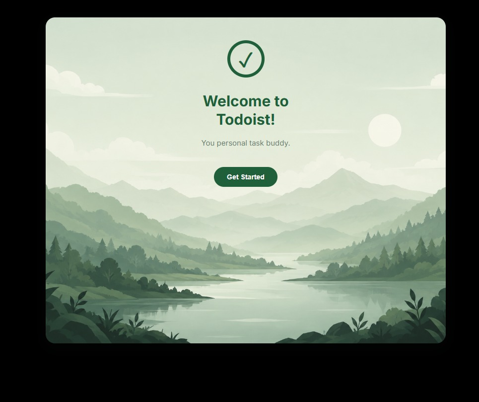
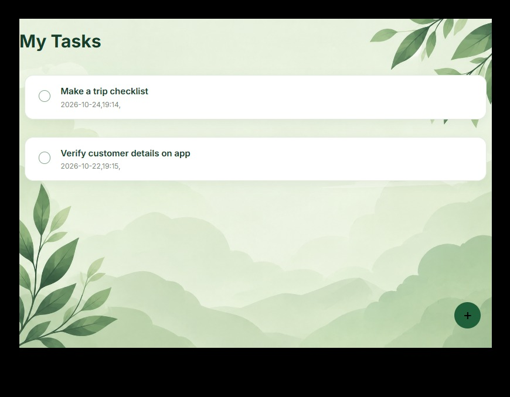

# Todoist — Task Management App

A simple task management app built with React and Vite to help users organise and manage their daily tasks.

## Screenshots

### Main Interface


### Task List Demo


## Built With
- React
- JavaScript
- CSS
- Vite

## Run Locally

1. Clone the repository:
   ```bash
   git clone YOUR_REPOSITORY_URL
   ```
2. Navigate into the project:
   ```bash
   cd Todoist
   ```
3. Install dependencies:
   ```bash
   npm install
   ```
4. Start the development server:
   ```bash
   npm run dev
   ```

## About

This project is a hands-on React project focused on building a user interface for managing tasks.
